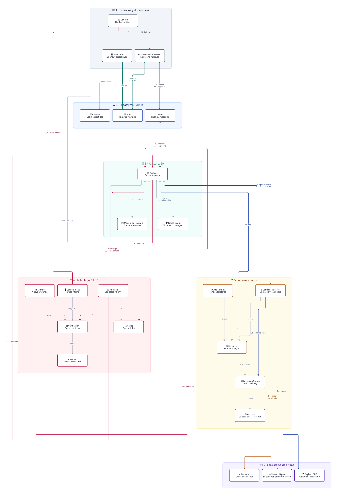

<p align="center">
  
</p>

<h1 align="center">NomikOS</h1>

<p align="center">
  Every account owns its AI orchestrator, wallets, and audit trail.
  Its agents pay for metered services without ever asking the user to sign.
</p>

## What problem this solves

Connected devices are easy to build and hard to trust. A voice assistant that can
browse services, place calls, or move funds on your behalf raises three questions
that most stacks answer poorly: whose intelligence is reasoning, whose money is
being spent, and who verified the outcome. NomikOS answers all three with
architecture instead of policy documents. Every account (email plus password)
receives its own orchestrator that reasons exclusively with that account's
language-model provider and credentials, operates on that account's chosen Solana
network with that account's delegated wallet, and settles every metered action
through an explicit payment handshake. The user never signs a transaction. The
device never holds a Solana keypair. And when an agent works in a high-stakes
domain, a separate verification layer checks its output against rules the agent
cannot see or change, with a human signing off before anything is final.

## How the system works

A typical turn starts at the microphone of a Raspberry Pi running the NomikOS
image or an ESP32-S3 with an AMOLED touch display. Local speech recognition
transcribes the utterance and the device forwards the text to the API, which hands
the turn to the orchestrator under the same identity. The orchestrator applies an
input safety shield, reasons with the account's own model, and calls tools as
needed. The turn itself is free. Every downstream resource the agent touches, by
contrast, is metered.

Metering follows the x402 pattern. A protected resource answers the first request
with HTTP 402 and an invoice that names the resource, the amount in lamports, and
the payee. The orchestrator then asks the account's delegated payment service to
settle that invoice. The service decrypts the account's keypair in memory,
checks per-transaction and daily limits, signs an ed25519 Solana transfer on the
account's own network, and polls for on-chain confirmation. The orchestrator
retries the original request with the invoice identifier in the X-Payment header.
The gateway verifies ownership, settlement, and freshness, consumes the invoice
in a single atomic step so it can never be replayed, and only then executes the
resource. A repeated payment is rejected as a conflict, and an invoice belonging
to another account is rejected as forbidden. The ledger records each step, and a
background settler keeps confirming transactions until they are final or have
exhausted their retries.

Devices join through fleet pairing. A board enrolls over HTTPS and receives a
short claim code that it shows on its screen, together with a one-time secret
whose hash is all the server stores. The owner redeems the code in the browser
panel, which atomically links the device to the account, and the board exchanges
its secret for a long-lived device token. From then on the device sends
heartbeats, reports its agent version, and inherits per-device spending limits.
Voice calls work the same way as any other metered resource: starting a call
creates a session and a toll for the first minute, and each subsequent minute
arrives as a fresh invoice, so a call that runs long simply keeps settling one
minute at a time through the bridge that drives the telephony software on the
board.

Content and business applications sit behind the same tollbooth. The reference
application is a headless content manager, and every request the agent makes to
it — reading collections, creating records, uploading media — costs one micro
toll that is consumed only if the application actually answered. Additional
applications are installed from a local registry through a tested installer
script, at which point their tools appear in the agent's catalog automatically.
A development faucet drips real Devnet SOL from a treasury keypair into each
account's delegated wallet so the full settlement path can be exercised
on-chain without touching mainnet funds.

The legal-agent workshop extends the same trust model to autonomous reasoning.
In the first session, a runner reads only the visible case documents through a
small files API, plans with its own checklist, and submits a draft legal
memorandum that may contain errors or omissions. In the second session, a
verifier that runs in a separate process and that the agent cannot influence
compares the memorandum against a ground truth the agent never sees. It checks
literal citations, rejects invented exhibits, enforces a minimum citation
count, and requires an explicit refusal whenever newly released evidence has
not been incorporated. Effectful tools stay blocked until the latest verdict
passes. External world events can inject new evidence mid-run, refusals
escalate to a human automatically, and a web console shows every turn,
checklist item, and event while an attorney reviews and signs the final result
with a one-shot, human-only signature.

## Repository structure

The repository is a monorepo whose authoritative flow is captured in the D2
diagram at the root, rendered alongside it as SVG. The heart of the system is
the `api` service, a Rust binary built on axum with an embedded SQLite ledger.
It owns every piece of business state: identities and sessions, per-account
language-model providers with encrypted keys, chain configuration with one
generated wallet vault per network, sub-wallets and browser-connected wallet
references, metered invoices and payouts with their one-shot consumption
markers, the device fleet with claim codes and tokens, call sessions, and the
legal verification runs with their turns, verdicts, and events. It also speaks
raw Solana JSON-RPC and signs transfers with a pure ed25519 implementation
rather than a vendor SDK, and it signs its object-storage requests by hand for
the same reason. Nothing else in the repository stores business facts.

The `brain` service is the Python orchestrator that exposes the agentic
gateway. It resolves the caller's account context on every request, refuses to
reason without a valid session or without an active provider on that account,
shields both the incoming text and the outgoing reply with a small Llama Guard
model served locally on CPU, and runs a bounded tool-calling loop whose tools
all pass through the reactive payment handshake. Its catalog covers device and
network status, fleet state, metered calls, per-request application access,
invoice management, and the four legal tools for listing and reading case
documents, appending audit turns, and submitting memoranda. Before any
effectful tool executes in a legal context, a verification gate confirms the
run holds a passing verdict, and new world evidence is polled into the
conversation each iteration.

The `dapp` directory holds the browser panel, a Next.js application that
authenticates against the API as its identity provider and carries the
resulting bearer token inside an encrypted session cookie. Its authenticated
shell renders a 3D view of the reference device with a simulated touch screen,
proxies gateway conversations to the orchestrator under the session identity,
and manages the account through focused dialogs for the signing wallet and
network, language-model providers with live key validation, metered services,
and fleet pairing with a serial-port installer that can flash boards from the
browser.

Device software lives in `firmware`, where a no-standard-library Rust core
implements the on-device agent state machine, a host simulator reproduces voice
and telephony behavior on a workstation, and a dedicated crate targets the
ESP32-S3 with its round AMOLED display. The `os` directory builds the actual
Linux image for the Raspberry Pi through a Buildroot external tree, bundling
the agent daemon, local speech recognition and synthesis, the SIP bridge, and
the systemd units that start the voice loop once the board is paired. The
`dapps` directory hosts the application registry and the local content-manager
checkout that serves as the ecosystem's reference application. The workshop
material sits in `agent` with the session-one runner and its prompts, in
`cases` with the visible fictional dispute, in `ground_truth` with the
verifier-only checklists and rules, in `world` with the external event
injector, and in `ui` with the static review console served on its own port.
End-to-end coverage lives in `tests`, and the root Makefile is the front door
for installing, starting, testing, and imaging the whole system.

## Running the system

Prerequisites are a Rust toolchain, Python 3.13, Node.js, and Ollama for the
safety shields, with Docker available as an alternative deployment path. All
configuration flows from a single environment file at the repository root,
which is created from the provided template before generating secrets and
synchronizing each service. One install command compiles the API, creates the
Python environments, installs JavaScript dependencies, and pulls the two small
Ollama models. One start command then brings up the API on port 8080, the
orchestrator on port 8322, the shields on port 11434, the panel on port 3000,
and the reference application on port 3100, waiting for each health check in
turn. The verification console is intentionally separate and starts on port
8765 on demand. Status, log tailing, and shutdown are single commands, and the
smoke check confirms both health endpoints plus the gateway's rejection of
anonymous requests, which must answer unauthorized because reasoning without
an account is not permitted.

In Docker, the API and the panel run as containers while the orchestrator, the
shields, and the application stay on the host and are reached through the
host gateway address. The ledger directory is mounted from the host so data
survives container recreation, and the case and ground-truth directories are
mounted read-only so the verifier keeps working identically inside and outside
containers. The panel detects which deployment it serves and otherwise behaves
the same.

## Usage guide

### First start

Copy the template, generate the missing secrets, install once per machine,
and start the stack. The smoke check at the end must print two health lines
and a 401 for the anonymous gateway call, which proves the orchestrator
refuses to reason without an account.

```bash
cp .env.example .env && make secrets && make install && make up
make test-smoke
```

### Give the account a brain and funds

Register and log in to obtain a bearer token, then attach a language-model
provider to the account. The panel does this through its Models dialog with
live key validation; the direct equivalent is one API call. On Devnet, fund
the delegated wallet from the treasury faucet so tolls can settle on-chain.

```bash
curl -s -X POST http://localhost:8080/api/auth/register \
  -H 'Content-Type: application/json' \
  -d '{"email":"you@example.dev","password":"a-long-secret-here"}'
export TOK=$(curl -s -X POST http://localhost:8080/api/auth/login \
  -H 'Content-Type: application/json' \
  -d '{"email":"you@example.dev","password":"a-long-secret-here"}' \
  | python3 -c "import json,sys; print(json.load(sys.stdin)['token'])")
curl -s -X PUT http://localhost:8080/api/accounts/me/llm \
  -H "Authorization: Bearer $TOK" -H 'Content-Type: application/json' \
  -d '{"provider":"nvidia-nim","api_key":"nvapi-...","models":["meta/muse-glimmer-30b"],"default_model":"meta/muse-glimmer-30b"}'
curl -s -X POST http://localhost:8080/api/dev/faucet \
  -H "Authorization: Bearer $TOK"
```

### Talk to the agent

Send text to the gateway with the account token. The answer carries the
reply plus the tools used, both shield verdicts, the payment events, and the
legal verification block when the conversation touches a case. On the panel
the same flow starts by touching the simulated device screen, while physical
boards post transcriptions to the voice endpoint under their own identity.

```bash
curl -s -X POST http://localhost:8322/v1/agentic-gateway \
  -H "Authorization: Bearer $TOK" -H 'Content-Type: application/json' \
  -d '{"text":"Check API health and summarize my wallet balance"}'
```

### Pair a device

The board enrolls and shows a short claim code. The owner redeems that code
in the Fleet dialog, which links board and account atomically. The board then
trades its one-time secret for a long-lived device token and starts sending
heartbeats. The API path below mirrors exactly what the panel and the
firmware do on their own.

```bash
curl -s -X POST http://localhost:8080/api/devices/enroll \
  -H 'Content-Type: application/json' \
  -d '{"board":"esp32-s3-amoled-143","pubkey":"<board-ed25519-pubkey>","name":"bench-01"}'
curl -s -X POST http://localhost:8080/api/devices/claim \
  -H "Authorization: Bearer $TOK" -H 'Content-Type: application/json' \
  -d '{"code":"<CODE-FROM-SCREEN>"}'
curl -s -X POST http://localhost:8080/api/devices/token \
  -H 'Content-Type: application/json' \
  -d '{"device_id":"<dev-id>","enroll_secret":"<secret-from-enroll>"}'
```

### Calls and applications

The agent places metered calls through its tools, paying one toll per minute
without user interaction. Called directly, the first request answers 402 with
the invoice for minute zero, and each settled minute returns the invoice for
the next, which sets the one-request-per-minute cadence. Application requests
behave the same way: one toll per call, consumed only when the application
actually answers.

```bash
curl -s -X POST http://localhost:8080/api/calls \
  -H "Authorization: Bearer $TOK" -H 'Content-Type: application/json' \
  -d '{"destination":"+15550123456"}'
```

### The legal workshop end to end

Open a run for the fictional dispute, draft with the session-one runner, and
optionally inject new evidence mid-run. The deterministic path submits a
memorandum from a file; without that flag the runner drives the live gateway
instead. Watch turns, checklist, and events in the review console, correct
and resubmit on failure, and let the attorney sign once the verdict passes.
The second signature attempt is rejected, which is the expected one-shot
behavior.

```bash
RID=$(curl -s -X POST http://localhost:8080/api/legal/runs \
  -H "Authorization: Bearer $TOK" -H 'Content-Type: application/json' \
  -d '{"case_id":"northbridge-v-caldera"}' \
  | python3 -c "import json,sys; print(json.load(sys.stdin)['run']['id'])")
cd agent && BEARER=$TOK python3 run.py --memo-file memorandum.md && cd ..
cd world && BEARER=$TOK python3 inject.py --run $RID \
  --doc exhibit-D.md --excerpt "Expert report excerpt..." && cd ..
xdg-open "http://127.0.0.1:8765/?run=$RID"
curl -s -X POST http://localhost:8080/api/legal/runs/$RID/signoff \
  -H "Authorization: Bearer $TOK" -H 'Content-Type: application/json' \
  -d '{"attorney":"Jordan Ellis <BAR-042>"}'
```

### Daily commands

Check health, follow a service log, open the review console, run the fast
contract battery, and shut everything down with one command each.

```bash
make status
make logs svc=brain
make ui
make test
make down
```

## Hardware

The supported voice board is a Raspberry Pi 4 flashed with the system image
produced by the image target, which outputs a standard SD card file that is
written to removable media with the usual disk tools. On first boot with
network access the board enrolls, prints its claim code to the console, and
waits to be redeemed in the fleet dialog. With a USB microphone attached, the
voice service starts automatically after pairing and the full loop of capture,
transcription, reasoning, and spoken reply runs without further setup.
Optionally, SIP trunk credentials enable real telephony through the on-board
bridge. The companion display board is an ESP32-S3 with a round AMOLED panel
that is flashed over USB with the Wi-Fi credentials it should join, after
which it shows its own claim code on screen and pairs the same way.

## Testing

The suite contains eighteen end-to-end files with one hundred tests that run
serially against live services and treat the public HTTP contracts as law.
They cover ecosystem health, identity with revocation and rate limiting,
per-account language-model and chain configuration, the payment gateway
including replay and ownership conflicts, the orchestrator's authentication
and shielding behavior, the complete diagram flow with a real account, fleet
pairing and limits, voice calls with their SIP bridge, voiced application
access behind tolls, real on-chain settlement, the application store, the
device simulator, and the two legal verification suites that exercise the
rules engine, world events, the review console contract, and the full
human-in-the-loop lifecycle. The fast battery runs the hard-contract subset
for quick iteration, while a single suite can be selected by path whenever a
change is scoped.

## Things worth knowing

### Configuration is centralized

The root environment file is the only configuration that matters. Each
service keeps an example file that acts as its contract, and the sync
command overlays every non-empty central value onto those defaults. A new
variable therefore belongs in the service example first and in the central
file second; anything else is silently ignored by design.

```bash
make env
```

### Identity and money in one paragraph

Every authenticated call carries `Authorization: Bearer`, issued either to a
human session or to a paired device, and an invalid token fails closed with
401 rather than degrading to anonymous behavior. Devices never sign money or
legal outcomes: the delegated service signs with the account keypair after
checking ownership and both spending limits. Amounts are always expressed in
lamports, invoices die on first use, replays answer 409, and foreign invoices
answer 403. Internalize those four facts and the whole payment surface makes
sense.

### Machine quirks

The workspace path ends with a literal space, so quote it in every shell
command or the path silently resolves elsewhere. The orchestrator's Python
environments embed absolute paths in their launchers, so moving the folder
breaks them; delete and recreate the environment and reinstall requirements
when the server reports a missing interpreter. The safety shields run on CPU
on purpose because the shared integrated GPU runs out of memory on long
guard prompts, which used to surface as intermittent shield failures. Live
logs for every service sit under `/tmp/nomikos` and are tailed by service
name.

```bash
rm -rf brain/.venv && python3 -m venv brain/.venv \
  && brain/.venv/bin/pip install -r brain/requirements.txt
```

### Verification boundaries

The checklist endpoint and the review console exist for humans. The agent
has no tool that reaches the checklist, the verdicts, or the ground truth,
so it cannot grade its own homework even if prompted to try. The console
keeps the pasted bearer token in page memory only and never persists it.
Ground-truth permissions of 700 and 600 are a local convention worth
reapplying after a fresh clone, with the real isolation coming from process
separation: only the API process ever opens those files.

### The diagram

<p align="center">
  
</p>

<p align="center">
  <em>Authoritative flow. Source: <code>diagram.d2</code>.</em>
</p>

## Security model

Passwords are hashed with Argon2id and sessions are opaque tokens of which
only hashes are stored, so a database read alone yields no usable credential
and logout revokes immediately. Provider keys and signing keypairs are encrypted at rest with a 32-byte
master key using XChaCha20-Poly1305 and are decrypted only in memory at the
moment of use, never written to logs or responses. Payments are one-shot by
construction, scoped to the owning account, and bounded by per-transaction
and daily limits before any signature happens. Reasoning is fenced on both
sides by content shields, high-stakes agent output additionally requires a
passing rule-based verdict the agent cannot influence, and final legal
acceptance requires a human signature that cannot be replayed or delegated to
a device. Secrets, live ledgers, and treasury keypairs stay out of version
control by ignore rules, with each service shipping only an example
environment template.
